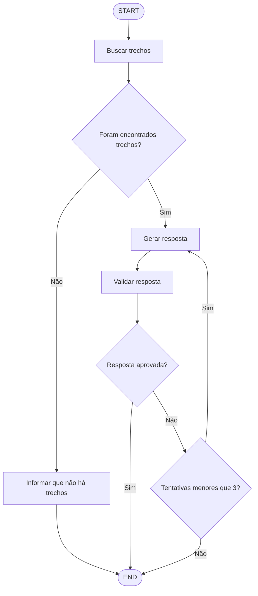

# Assistente RAG com LangChain.js e LangGraph

Projeto de um assistente inteligente baseado em RAG (*Retrieval-Augmented Generation*), desenvolvido em JavaScript, utilizando LangChain.js, LangGraph e Neo4j.

O objetivo é permitir que o usuário faça perguntas sobre o conteúdo de uma apostila em PDF e receba respostas contextualizadas, utilizando os trechos mais relevantes do documento como fonte de informação.

## Tecnologias utilizadas

- **Node.js:** ambiente de execução JavaScript.
- **LangChain.js:** integração com modelos de linguagem.
- **LangGraph:** organização e controle do fluxo de execução do RAG.
- **OpenRouter:** acesso ao modelo de linguagem.
- **Hugging Face Transformers.js:** geração local de embeddings.
- **Neo4j:** armazenamento dos chunks e busca vetorial.
- **Express:** criação da API.
- **HTML, CSS e JavaScript:** interface do usuário.
- **Docker:** execução do banco de dados Neo4j.

## Como funciona

O projeto utiliza a arquitetura RAG para recuperar informações de documentos e gerar respostas fundamentadas no conteúdo armazenado.

### 1. Ingestão dos documentos

Antes de responder às perguntas, o documento PDF passa por algumas etapas:

1. Leitura e extração do texto.
2. Divisão do conteúdo em chunks.
3. Geração de embeddings para representar semanticamente os trechos.
4. Armazenamento dos chunks e seus embeddings no Neo4j.

### 2. Fluxo de perguntas com LangGraph

Quando o usuário envia uma pergunta, o LangGraph controla a execução das seguintes etapas:

1. **Buscar trechos:** realiza a busca vetorial no Neo4j para recuperar os trechos relacionados à pergunta.
2. **Verificar resultados:** verifica se foram encontrados trechos para continuar o processamento.
3. **Gerar resposta:** utiliza o modelo de linguagem do OpenRouter para elaborar uma resposta com base no contexto recuperado.
4. **Validar resposta:** um segundo processamento avalia se a resposta está correta e fundamentada nos trechos encontrados.
5. **Corrigir resposta:** caso a validação seja reprovada, o feedback é enviado ao gerador para uma nova tentativa.

O processo de geração e validação pode ocorrer por até três tentativas.

### 3. Fluxo do LangGraph



## Estrutura do projeto

```text
assistente-rag-langchain/
│
├── documentos/
│
├── public/
│   ├── index.html
│   ├── script.js
│   └── style.css
│
├── src/
│   ├── config/
│   │   └── database.js
│   │
│   ├── lerPdf.js
│   ├── chunking.js
│   ├── embedding.js
│   ├── gerarEmbeddings.js
│   ├── salvarChunks.js
│   ├── buscarTrechos.js
│   ├── responder.js
│   ├── grafo.js
│   ├── server.js
│   ├── testarGrafo.js
│   └── testConnection.js
│
├── .env
├── .gitignore
├── compose.yaml
├── package.json
└── package-lock.json
```

## Configuração do ambiente

### Pré-requisitos

- Node.js
- Docker Desktop
- Neo4j
- Chave de API do OpenRouter

### Instalação das dependências

Clone o repositório e entre na pasta do projeto:

```bash
git clone URL_DO_REPOSITORIO
cd assistente-rag-langchain
```

Instale as dependências:

```bash
npm install
```

### Variáveis de ambiente

Crie um arquivo `.env` na raiz do projeto com as configurações necessárias para o OpenRouter e para a conexão com o Neo4j.

As variáveis devem corresponder aos nomes utilizados nos arquivos de configuração do projeto.

**Importante:** não compartilhe nem envie o arquivo `.env` para o Git.

## Executando o projeto

Com o Neo4j em execução e devidamente configurado, inicie o servidor:

```bash
node src/server.js
```

Acesse a aplicação pelo navegador:

```text
http://localhost:3000
```

## Testando o LangGraph

Para executar o fluxo diretamente pelo terminal, sem utilizar a interface web:

```bash
node src/testarGrafo.js
```

Esse arquivo permite acompanhar a execução dos nós do grafo e visualizar sua estrutura utilizando Mermaid.

## Objetivo de aprendizado

Este projeto também tem como finalidade estudar e aplicar conceitos de:

- Retrieval-Augmented Generation (RAG).
- Embeddings e busca vetorial.
- Integração com modelos de linguagem.
- LangChain.js.
- LangGraph: estados, nós, arestas e rotas condicionais.
- Fluxos com ciclos e validação de respostas.
- Desenvolvimento de APIs com Express.